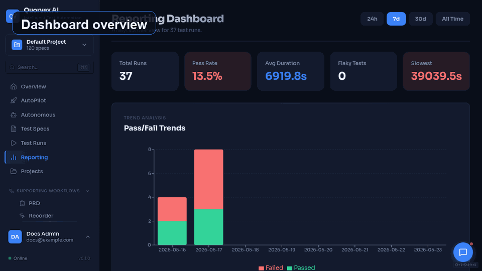
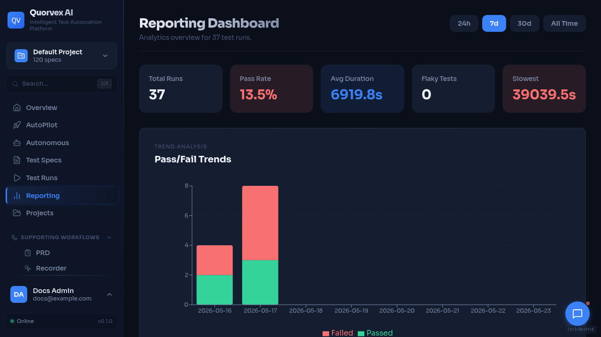

<p align="center">
  <h1 align="center">SentinelQA</h1>
  <p align="center">
    <strong>Your QA Engineer That Never Stops Learning.</strong>
  </p>
  <p align="center">
    Autonomous AI quality assurance for teams that need evidence-backed browser testing, self-healing, and real defect detection.
  </p>
</p>

---

SentinelQA is a private hackathon-ready quality assurance platform that turns acceptance criteria into executable Playwright tests, executes them, records evidence, and safely repairs broken locators when the change is semantically equivalent.

The output is ordinary repository code. You can review it, commit it, run it in CI, and keep running it later without model calls.



## Why It Matters

- **AI speed, standard test code**: agents help plan, generate, validate, and heal tests while your team keeps readable Playwright files.
- **Self-hosted by design**: app URLs, credentials, traces, recordings, and test data stay inside infrastructure you control.
- **Coverage beyond UI happy paths**: grow from E2E generation into API, load, security, database, mobile, LLM evaluation, PRD coverage, and autonomous discovery.
- **Operational surface included**: dashboard, queues, browser pool, schedules, credentials, artifacts, RBAC, CI gates, TestRail, Jira, and backup paths.

## Quick Start

All useful modes require AI provider credentials. Copy the relevant environment file, set the provider token, and run `make check-env` before relying on generated output.

| Path | Best for | Command |
|------|----------|---------|
| Evaluator demo | Fastest local product trial with the lightweight SQLite stack | `docker compose -f docker-compose.minimal.yml up -d` |
| Contributor dev | Full Docker development stack with dashboard, queues, storage, VNC, and frontend hot reload | `make dev` |
| Production/company | Compose app behind company DNS/TLS/nginx in external-nginx mode | `make start` |

Evaluator path:

```bash
git clone https://github.com/NihadMemmedli/quorvex_ai.git
cd quorvex_ai
cp .env.example .env
# Edit .env with your AI provider credentials.
make check-env
docker compose -f docker-compose.minimal.yml up -d
```

Contributor path:

```bash
git clone https://github.com/NihadMemmedli/quorvex_ai.git
cd quorvex_ai
cp .env.prod.example .env.prod
# Edit .env.prod with your AI provider credentials.
make check-env
make dev
```

Open the dashboard at [http://localhost:3000](http://localhost:3000).

For production or company-network deployments, use `.env.prod`, keep real secrets out of Git, run `make start`, and put company DNS/TLS/nginx in front of the Compose app. The repo-managed nginx container is a legacy opt-in path, not the default company deployment mode. See [On-Premises Deployment](docs/guides/company-deployment.md).

## Open In A Cloud Dev Environment

These links start a browser-based development workspace, but they do not provide AI credentials. Add your provider token in the workspace environment before running generation flows.

[](https://gitpod.io/#https://github.com/NihadMemmedli/quorvex_ai)
[](https://codespaces.new/NihadMemmedli/quorvex_ai?quickstart=1)

## From Spec To Playwright

Input spec:

```markdown
# Test: Login Form Validation

## Steps
1. Navigate to https://the-internet.herokuapp.com/login
2. Enter "tomsmith" into the Username field
3. Enter "SuperSecretPassword!" into the Password field
4. Click the "Login" button
5. Verify the page displays "Secure Area" heading
6. Click the "Logout" button
```

Generated output:

```ts
import { test, expect } from '@playwright/test';

test('logs in with valid credentials and logs out', async ({ page }) => {
  await page.goto('https://the-internet.herokuapp.com/login');
  await page.getByLabel('Username').fill('tomsmith');
  await page.getByLabel('Password').fill('SuperSecretPassword!');
  await page.getByRole('button', { name: 'Login' }).click();
  await expect(page.getByRole('heading', { name: 'Secure Area' })).toBeVisible();
  await page.getByRole('link', { name: 'Logout' }).click();
});
```

See the maintained [examples index](docs/tutorials/examples.md) for UI, API, authenticated-flow, generated-output, and specialized-testing examples.

## Feature Map

| Area | What Quorvex supports |
|------|------------------------|
| Test generation | Plain-English specs to Playwright, browser-backed planning, validation, Smart Check reuse, hybrid healing, visual regression, reusable `@include` templates |
| PRD and coverage | PRD upload, feature extraction, requirements generation, duplicate detection, RTM, gap analysis, suggested tests |
| Autonomous agents | App discovery, live browser state, generated task artifacts, recurring missions, long-running workflows, approval gates |
| Specialized testing | OpenAPI/API tests, K6 load tests, quick/Nuclei/ZAP security scans, database checks, mobile smoke flows, LLM evaluations |
| Quality intelligence | Regression batches, flaky test detection, pass-rate trends, failure classification, analytics, generated reports |
| Operations | Project isolation, RBAC, encrypted credentials, browser pools, Redis queues, MinIO storage, backups, schedules, GitHub/GitLab integration |



## Documentation

Full documentation is published at [nihadmemmedli.github.io/quorvex_ai](https://nihadmemmedli.github.io/quorvex_ai/).

| Need | Start here |
|------|------------|
| First successful run | [Getting Started](docs/tutorials/getting-started.md) |
| Choose a setup path | [Setup Options](docs/guides/setup-options.md) |
| Browse maintained examples | [Curated Examples](docs/tutorials/examples.md) |
| Configure environment variables | [Environment Variables](docs/reference/environment-variables.md) |
| Understand architecture | [System Overview](docs/explanation/system-overview.md) |
| Deploy behind company nginx | [On-Premises Deployment](docs/guides/company-deployment.md) |
| Troubleshoot operations | [Troubleshooting](docs/guides/troubleshooting.md) |

To browse docs locally:

```bash
pip install -r requirements-docs.txt
mkdocs serve
```

## Project Health

- Bugs, questions, support expectations: [SUPPORT.md](SUPPORT.md)
- Security reporting and supported versions: [SECURITY.md](SECURITY.md)
- Maintainer and review expectations: [MAINTAINERS.md](MAINTAINERS.md)
- Release checklist and versioning: [RELEASE.md](RELEASE.md)
- Changelog: [CHANGELOG.md](CHANGELOG.md)

## Contributing

Pull requests are welcome when they include a clear risk summary, tests run, and any docs drift. Start with [CONTRIBUTING.md](CONTRIBUTING.md), the [good first issues guide](docs/community/good-first-issues.md), and the project-specific pull request template.

## Repository notice

The repository retains its original legal license file for compliance purposes, but the public-facing product presentation for this hackathon is branded as SentinelQA and does not surface licensing notices in the demo experience.
